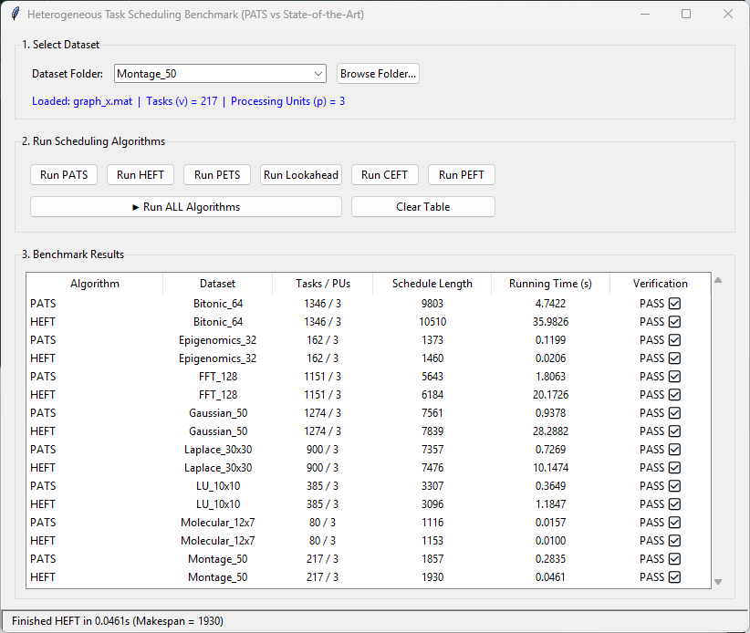

# PATS: Predict and Arrange Task Scheduling (Python Implementation)

This repository provides a Python implementation of the **Predict and Arrange Task Scheduling (PATS)** algorithm, originally published in *Simulation Modelling Practice and Theory* (2016), alongside Python implementations of five established heuristic scheduling algorithms for reference and comparison.

> **Note on Code Migration:** This codebase was migrated from the original MATLAB scripts written around 2015–2016 into Python with a basic Tkinter GUI to make the experiments easier to run without requiring a MATLAB license. As this is a direct translation of older research code, there may still be rough edges, unoptimized sections, or minor bugs. Any feedback, bug reports, or pull requests are sincerely appreciated.

---

## Overview

Scheduling Directed Acyclic Graphs (DAGs) onto heterogeneous computing systems requires balancing schedule length (makespan) with algorithmic execution time. **PATS** uses a simple two-phase heuristic approach:

1. **Level-Based Predictive Scheduling (Phase 1):** Tasks are scheduled level-by-level from top to bottom using an Earliest Finish Time (EFT) candidate list to keep time complexity low.
2. **Idle Slot Reduction (Phase 2):** A refinement pass traverses the schedule upward to compress idle gaps on processing units where task dependencies allow.

For baseline comparison, this repository also includes standalone Python implementations of five well-known scheduling heuristics:
* **HEFT** (Heterogeneous Earliest Finish Time — Topcuoglu et al., 2002)
* **PETS** (Low Complexity Performance Effective Task Scheduling — Ilavarasan & Thambidurai, 2007)
* **Lookahead** (Lookahead Variant of HEFT — Bittencourt et al., 2010)
* **CEFT** (Constrained Earliest Finish Time — Khan, 2012)
* **PEFT** (Predict Earliest Finish Time — Arabnejad & Barbosa, 2014)

### Potential Modern Applications
Although originally developed for traditional grid and cluster computing, the core DAG scheduling mechanics of **PATS**—specifically low-overhead predictive assignment and idle-slot compression—naturally extend to modern AI workloads, such as:
* **LLM Inference Pipelines:** Minimizing pipeline bubbles and idle GPU time across heterogeneous multi-GPU setups.
* **Agentic Workflows:** Orchestrating multi-step, dependent AI agent tasks across models with varying compute costs and latencies.

---

## Benchmark Datasets & Graph Generator

The included `generate_datasets.py` script generates synthetic DAG datasets in `.mat` format (`graph_x.mat`, `size_a.mat`, `size_b.mat`), allowing users to freely adjust parameters such as the number of processing units (`NUM_PUS`), Communication-to-Computation Ratio (`CCR`), workload weights, and random seeds.

The generator supports eight common workflow and scientific computing DAG structures:
1. **Fast Fourier Transformation (`FFT`):** Recursive divide-and-conquer binary tree followed by butterfly stages (`v = (2m - 1) + m log2(m)`).
2. **Gaussian Elimination (`Gaussian`):** Constructed recursively from the classic 14-node (`m = 5`) Gaussian Elimination DAG example in Topcuoglu et al. (2002), using Poisson-distributed weights and bottom-aligned topological levels (`v = m(m + 1)/2 - 1`).
3. **Montage (`Montage`):** Astronomical image mosaic workflow featuring fork-join synchronization bottlenecks.
4. **Molecular Dynamics (`Molecular`):** Multi-stage diamond mesh structure with dense inter-layer dependencies.
5. **Epigenomics (`Epigenomics`):** Parallel data-processing pipelines with single entry and exit nodes.
6. **Laplace Equation Solver (`Laplace`):** Symmetric 2D wavefront grid (`v = m^2`).
7. **Bitonic Sorting Network (`Bitonic`):** Symmetric multi-stage compare-and-swap network.
8. **Block LU Decomposition (`LU`):** Matrix factorization workflow alternating between diagonal, panel, and trailing submatrix updates.

*(Note: Depending on the graph topology, CCR, and random seed, different heuristics exhibit different strengths—for instance, PATS tends to perform well on symmetric, level-balanced graphs like FFT and Laplace, whereas global critical-path heuristics like HEFT or Lookahead can achieve shorter makespans on certain funnel-shaped or high-CCR graphs.)*

---

## Sample Benchmark Results

Below are sample runs executed via the included GUI tool on **3 heterogeneous processing units** (for reference only; results vary with random seeds, CCR settings, and hardware):

### Case 1: `FFT_64` (511 Tasks, 3 PUs)

| Algorithm | Schedule Length (Makespan) | Running Time (s) | Verification |
| :--- | :---: | :---: | :---: |
| **PATS** | 2528 | 0.4209 | PASS |
| **HEFT** | 2696 | 1.8848 | PASS |
| **PETS** | 2712 | 1.8656 | PASS |
| **Lookahead** | 2679 | 12.9103 | PASS |
| **CEFT** | 3169 | 2.7435 | PASS |
| **PEFT** | 2840 | 3.0773 | PASS |

### Case 2: `Gaussian_50` (1,274 Tasks, 3 PUs)

| Algorithm | Schedule Length (Makespan) | Running Time (s) | Verification |
| :--- | :---: | :---: | :---: |
| **PATS** | 7561 | 0.9060 | PASS |
| **HEFT** | 7839 | 27.2014 | PASS |
| **PETS** | 7863 | 26.8151 | PASS |
| **Lookahead** | 7958 | 207.5065 | PASS |
| **CEFT** | 9110 | 37.8991 | PASS |
| **PEFT** | 8035 | 51.5743 | PASS |

### Interactive Benchmark GUI


*Figure 1: Sample comparison between PATS and the classic HEFT baseline across eight DAG structures. While PATS achieves faster execution times and shorter schedules on level-symmetric graphs, HEFT remains a strong baseline, outperforming PATS on structures such as Block LU (`LU_10x10`).*

---

## Repository Structure

```text
PATS-Task-Scheduling/
├── algorithms/
│   ├── __init__.py
│   ├── pats.py             # Predict and Arrange Task Scheduling (PATS)
│   ├── heft.py             # Heterogeneous Earliest Finish Time (HEFT)
│   ├── pets.py             # Performance Effective Task Scheduling (PETS)
│   ├── lookahead.py        # Lookahead HEFT
│   ├── ceft.py             # Constrained Earliest Finish Time (CEFT)
│   └── peft.py             # Predict Earliest Finish Time (PEFT)
├── datasets/               # Generated or original .mat task graph folders
├── docs/
│   └── gui_demo.png        # Screenshot of the benchmark GUI
├── Alg_benchmark.py        # Tkinter GUI for running and comparing algorithms
├── generate_datasets.py    # Script to generate synthetic DAG datasets (.mat)
├── requirements.txt        # Required Python packages
└── README.md
```

---

## Getting Started

### Prerequisites
* Python 3.10 or higher
* `numpy` and `scipy`

### Installation

1. Clone this repository:
   ```bash
   git clone https://github.com/Anan-SLRI/PATS-Task-Scheduling
   cd PATS-Task-Scheduling
   ```

2. Install the required dependencies:
   ```bash
   pip install -r requirements.txt
   ```

### Usage

1. **(Optional) Generate Synthetic Datasets:**
   Run the dataset generator script to populate the `datasets/` folder (parameters such as `NUM_PUS`, `CCR`, or graph sizes can be edited inside `generate_datasets.py`):
   ```bash
   python generate_datasets.py
   ```

2. **Launch the Benchmark GUI:**
   ```bash
   python Alg_benchmark.py
   ```
   * Select a dataset folder from the dropdown menu or click **Browse Folder...** to load any directory containing `graph_x.mat` and `size_a.mat`.
   * Click any individual algorithm button to run it, or click **Run ALL Algorithms** to evaluate all six methods sequentially.
   * The **Verification** column checks that no overlapping tasks occur on any processing unit and that total execution times match the input graph.

---

## Acknowledgments

Deepest gratitude is extended to the advisors and mentors for their invaluable guidance, support, and inspiration throughout this research:
* **Assoc. Prof. Peraphon Sophatsathit, Ph.D.**
* **Prof. Chidchanok Lursinsap, Ph.D.**
* **Assoc. Prof. Suphakant Phimoltares, Ph.D.**
* **Prae Chirawatkul, Ph.D.**

Grateful acknowledgment is also made to the **Advanced Virtual and Intelligent Computing (AVIC) Research Center, Chulalongkorn University**, for providing the research environment and resources that made this work possible.

Finally, sincere thanks are extended to **Haluk Topcuoglu, Salim Hariri, and Min-You Wu (2002)** for their seminal work on **HEFT**, which served as a foundational inspiration for the development of **PATS** and continues to guide the broader task scheduling research community, as well as to the authors of **PETS**, **Lookahead**, **CEFT**, and **PEFT**.

---

## References & Citation

* **HEFT:** H. Topcuoglu, S. Hariri, and M.-Y. Wu, *"Performance-effective and low-complexity task scheduling for heterogeneous computing,"* IEEE Transactions on Parallel and Distributed Systems, vol. 13, no. 3, pp. 260–274, 2002.
* **PETS:** E. Ilavarasan and P. Thambidurai, *"Low complexity performance effective task scheduling algorithm for heterogeneous computing environments,"* Journal of Computer Sciences, vol. 3, no. 2, pp. 94–103, 2007.
* **Lookahead:** L. F. Bittencourt, R. Sakellariou, and E. R. M. Madeira, *"DAG scheduling using a lookahead variant of the heterogeneous earliest finish time algorithm,"* in Proc. 18th Euromicro Conference on Parallel, Distributed and Network-based Processing (PDP), pp. 27–34, 2010.
* **CEFT:** M. A. Khan, *"Scheduling for heterogeneous systems using constrained critical paths,"* Parallel Computing, vol. 38, no. 4–5, pp. 175–193, 2012.
* **PEFT:** H. Arabnejad and J. G. Barbosa, *"List scheduling algorithm for heterogeneous systems by an optimistic cost table,"* IEEE Transactions on Parallel and Distributed Systems, vol. 25, no. 3, pp. 682–694, 2014.

If this implementation proves useful in your research, please consider citing the original paper:

```bibtex
@article{niyom2016fast,
  title={A fast predictive algorithm with idle reduction for heterogeneous system scheduling},
  author={Niyom, Anan and Sophatsathit, Peraphon and Lursinsap, Chidchanok},
  journal={Simulation Modelling Practice and Theory},
  volume={63},
  pages={83--103},
  year={2016},
  publisher={Elsevier},
  doi={10.1016/j.simpat.2016.02.006}
}
```

---

## License

This project is shared for academic and research purposes under the MIT License.
